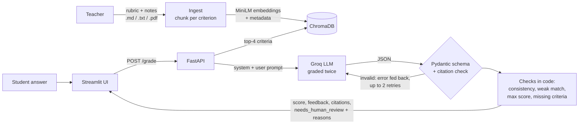

# RubricRAG

[](https://github.com/priyxnshu07/Rubric_RAG/actions/workflows/ci.yml)

A rubric-grounded feedback assistant for teachers. A teacher uploads a rubric and course notes; a student answer is graded by an LLM against the **retrieved rubric criteria**. The result is a score, kind per-criterion feedback for ages 8–14, citations to the exact rubric text used, and a **"needs teacher review"** flag whenever the system isn't sure.

## Problem

Asking an LLM to "grade this" gives scores that are hard to trust: it invents its own criteria, it's inconsistent between runs, and it can't show *why* marks were lost. RubricRAG makes the model grade only against the teacher's own rubric, checks its output in code, and tells the teacher when to look again.

## Architecture



| Part | Tool | File |
|---|---|---|
| Ingestion and chunking | pypdf, regex criterion detection | `app/ingest.py`, `app/chunking.py` |
| Vector store | ChromaDB, `all-MiniLM-L6-v2` | `app/store.py` |
| Grading | Groq (`openai/gpt-oss-120b`), Pydantic | `app/grader.py`, `app/schemas.py` |
| API and UI | FastAPI, Streamlit | `app/main.py`, `app/ui.py` |
| Tests and eval | pytest (66 tests, mocked LLM), `eval/` | `tests/`, `eval/` |

## How it works

1. **Chunk one criterion per chunk.** A criterion starts at a line stating its points (`### Opening hook (2 points)`) and keeps all its score levels, so a level is never split from its criterion. Headings like `## Q1 Photosynthesis` are added as a prefix, so retrieval knows which question a criterion belongs to. Metadata: `chunk_id`, source file, criterion name, points and line numbers.
2. **Retrieve the top-4 criteria** for the question + answer. General rubric text is excluded, so it can't take a criterion's slot.
3. **Grade with separated prompts.** All instructions, including encouraging, age-appropriate language for 8–14-year-olds, go in the system prompt. The user message holds only data: chunks, question, and the answer wrapped in `<answer>` tags.
4. **Validate.** The output must match the schema `{score, max_score, criteria[{name, met, feedback, cited_chunk_ids}], overall_feedback, needs_human_review, reasons}`. Invalid JSON, or a cited id that wasn't retrieved, is sent back to the model with the exact error, up to 2 retries.
5. **Flag for teacher review** when any check fails:
   - the two grading runs differ by more than 1 point ("inconsistent scores");
   - the answer alone is far from every criterion ("weak rubric match", `MIN_RUBRIC_SIMILARITY`);
   - a criterion cites no rubric chunk, or a citation had to be rejected;
   - `max_score` doesn't match the cited criteria's points, or the score is lower than the criteria marked as met;
   - some of the question's criteria weren't retrieved;
   - the LLM itself flags the answer (off-topic, trying to instruct the grader).
6. **Log privately.** Logs contain only ids, scores, similarity and latency, never student text.

## Run

```bash
python3.11 -m venv .venv && source .venv/bin/activate
pip install -r requirements.txt
cp .env.example .env                         # add GROQ_API_KEY (free at console.groq.com)
python -m app.ingest data/public_speaking    # also: data/biology-quiz-1
uvicorn app.main:app --port 8000             # API, docs at http://localhost:8000/docs
streamlit run app/ui.py                      # UI at http://localhost:8501 (second terminal)
```

Docker (one container for both). On every push, GitHub Actions builds the image and smoke-tests it: the container starts, the API answers `/health` and lists the rubrics, and the UI responds (`.github/workflows/ci.yml`):

```bash
docker build -t rubricrag .
docker run --env-file .env -p 8501:8501 -p 8000:8000 rubricrag
```

`pytest` runs the tests with a mocked LLM, so no API key is needed; CI runs them on every push too. Tip: set `HF_HUB_OFFLINE=1` once the embedding model has downloaded, for faster start-up.

## Evaluation

**Large vs small model** on the public speaking rubric (`python -m eval.run_eval`; full output in [`eval/results.md`](eval/results.md)). Each answer goes through the full `/grade` logic:

| Metric | large (`openai/gpt-oss-120b`) | small (`openai/gpt-oss-20b`) |
|---|---|---|
| Human-scored answers | 12/12 | 12/12 |
| Exact agreement with human | 50% | 17% |
| Agreement within ±1 | 67% | 58% |
| Mean absolute error (points /8) | 1.00 | 1.33 |
| Responses with only valid citations (every criterion cited) | 100% | 100% |
| Flagged for human review | 100% | 100% |
| Flagged, ignoring 'weak rubric match' | 17% | 58% |
| Failed gradings (errors) | 0 | 0 |
| Avg latency per grading (2+ LLM calls) | 3.8 s | 3.9 s |
| Avg LLM calls per grading | 2.0 | 2.1 |
| Avg tokens in / out | 2212 / 1380 | 2067 / 1927 |
| Est. cost per 100 gradings | $0.116 | $0.073 |

Human scores are mine: one grader, total score per answer, written into `eval/answers.json`.

**Error analysis** ([`eval/error_analysis.md`](eval/error_analysis.md)):
- **The large model is the better grader** (50% exact against 17%, MAE 1.00 against 1.33), but **both are lenient**. The large model scored higher than me on 5/12 answers (+0.83 points on average), mostly on *average* answers, for example missing that a speech "wanders off".
- **Both models got the same 4 answers wrong,** which points to a rubric-reading gap rather than noise. Next step: put a few scored example answers in the prompt.
- **The safeguards didn't catch these errors.** None of the large model's 4 big misses was flagged. The checks catch structural problems (citations, totals, off-topic answers), not confident leniency, so "needs teacher review" means "unusual", not "wrong".
- The eval also exposed pipeline bugs, all fixed with tests: intro text taking a retrieval slot, Groq JSON-mode rejections not being retried, and rate-limit errors.

**Biology quiz** (10 hand-labelled answers across 3 questions, `python -m eval.run_biology_eval`):

| Metric | Result |
|---|---|
| Retrieval recall@4 (all of a question's criteria retrieved) | 1.00 |
| Score MAE vs my reference scores | 0.20 points out of 10 |
| Within 1 point / right criteria graded | 10/10 / 10/10 |
| Citation precision / invented citations | 1.00 / 0 |
| Flagged for review | 1/10 (an off-topic answer: the LLM flagged it and cited only notes) |

## Limitations

- **Small eval set:** 10 + 12 synthetic answers and a single labeller (me). Treat this as a sanity check, not a benchmark.
- **One rubric for the human-agreement test,** scored by one person (me), totals only. The results may not transfer to other subjects or rubric styles, and 12 answers can't separate "the model is lenient" from "I am strict".
- **English only:** the embedding model, the prompts and the criterion detection (`(N points)`) all assume English.
- **"Weak rubric match" doesn't suit skill rubrics:** it flagged 12/12 public speaking answers, because content similarity can't judge an open-topic speech. The threshold should be set per rubric.
- **The double-grading check is weak at temperature 0:** the two runs usually agree, and it doubles cost.
- **The review flag misses lenient grading:** it flagged none of the large model's real errors. The LLM still judges; the checks catch inconsistencies, not wrong judgements. Age-appropriate tone is prompted, not measured. Prompt injection is mitigated, not solved. There's no authentication.
